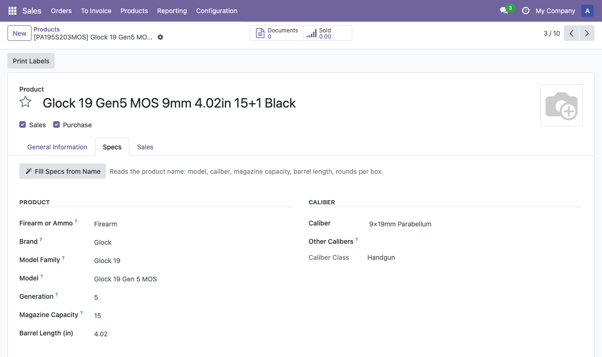

# Firearm & Ammo Specs for Odoo

Odoo module `gunsnprices_product_specs`: firearm and ammunition specs on products, filled in from the product name.

For gun shops, ammo stores and outdoor retailers that sell with Odoo. Type or import products the way they are
named, `Glock 19 Gen5 MOS 9mm 4.02in 15+1 Black` or `Federal American Eagle 9mm Luger 115gr FMJ, 50/Box`. One
click (or a whole selection) fills the model, caliber, magazine capacity, barrel length and rounds per box. Ammo
then gets its cost per round.

The parsing is done by [`gunsnprices`](https://pypi.org/project/gunsnprices/), the title parser behind the price
comparison site [GunsNPrices](https://gunsnprices.com). It is bundled in the module and runs inside Odoo: no
external service, no account, no API key.



## Features

- **Fields on products** (Specs tab): firearm or ammo, brand, model family, model, generation, caliber, other
  calibers, caliber class, magazine capacity, barrel length (in), rounds per box, cost per round.
- **Fill Specs from Name**: a button on the product form, and an action in the *Actions* menu of product and
  variant lists for a whole selection. A notification says how many products were updated, how many were
  already up to date and how many had no specs in their name.
- **Only empty fields are filled** unless *Overwrite Existing Specs* is on. Fields are never cleared: when the name
  gives nothing for a field, it keeps its value.
- **Fill on creation** (optional): every new product, including imported ones, gets its specs.
- **293 calibers** (`gnp.caliber`), most common first, with the spellings retailers use. Typing `300 blk`, `9mm
  luger`, `12ga` or `5.56 NATO` in the caliber field finds the caliber, and a CSV import with those spellings
  matches too.
- **Cost per round**: sales price divided by rounds per box, stored, so you can sort and filter by it.
- Search, filters and group-by for caliber, caliber class, brand and model family; optional list columns.
- Glock part numbers in the internal reference are decoded (`PA195S203MOS` gives Glock 19 Gen 5 MOS).

Models are recognized for 50 firearm brands (Glock, Sig Sauer, Smith & Wesson, Ruger, Springfield, Taurus, Henry,
Mossberg, Remington, Winchester and 40 more; the full list is on the store page). Calibers, capacity, barrel length
and rounds per box are read for any brand. Ammunition brands are not detected.

## Versions

| Branch | Odoo | Status |
|--------|------|--------|
| `18.0` | 18.0 | this branch |
| `19.0` | 19.0 | same code, made with `tools/port_to.py 19.0` |
| `20.0` | 20.0 | same code, made with `tools/port_to.py 20.0` (access rights become `security/ir.access.csv`) |

The module's tests pass on Odoo 18.0, 19.0 and 20.0 (Community, checked 2026-11-10, alone and together with Sales,
Inventory, Purchase, Point of Sale and eCommerce with demo data).

Odoo Online (SaaS) can't run it: third-party apps with Python code need Odoo.sh or an on-premise server.

## Install

1. Put the `gunsnprices_product_specs` folder in your addons path (on Odoo.sh: add this repository as a submodule
   of your project, or copy the folder into it).
2. *Apps* → *Update Apps List*, search for "Firearm & Ammo Specs", install.
3. *Settings* → *Firearm Specs* for the options and the caliber list.

Nothing has to be installed with pip. The module depends only on `product`.

### Why the parser is bundled and not an `external_dependencies`

A module that declares `external_dependencies = {"python": ["gunsnprices"]}` can't be installed where that package
is missing: Odoo checks the list before installing and refuses. On Odoo.sh it would mean adding `gunsnprices` to a
`requirements.txt` at the root of the branch, and the Odoo Apps store wants modules that install by copying the
folder into the addons path. So the parser ships inside the module (`lib/gunsnprices`, MIT code and CC BY 4.0
data) and no external dependency is declared.

If a newer release of the same series is installed with pip (`pip install -U "gunsnprices>=0.1,<0.2"`, or that
line in an Odoo.sh `requirements.txt`), the module uses it instead of the bundled copy. *Settings* → *Firearm Specs*
→ *Title Parser* shows which one is in use.

## Using it from code

```python
products = env["product.template"].search([("gnp_caliber_id", "=", False)])
stats = products._gnp_fill_specs(overwrite=False)   # {"updated": n, "unchanged": n, "not_found": n}
env["product.template"].with_context(gnp_no_fill=True).create({...})   # skip fill on creation
```

Field names: `gnp_product_kind`, `gnp_brand`, `gnp_model_family`, `gnp_model`, `gnp_generation`, `gnp_caliber_id`,
`gnp_other_caliber_ids`, `gnp_caliber_type`, `gnp_magazine_capacity`, `gnp_barrel_length`, `gnp_rounds_per_box`,
`gnp_cost_per_round`. System parameters: `gunsnprices_product_specs.overwrite`,
`gunsnprices_product_specs.fill_on_create`.

## Development

```sh
pip install ruff pytest lxml docutils gunsnprices==0.1.2
ruff check .
pytest -q                     # parsing and fill logic, manifest, data files, store page rules; no Odoo needed
```

Odoo tests (`gunsnprices_product_specs/tests`):

```sh
odoo-bin -d test --addons-path=/path/to/this/repo,/path/to/odoo/addons -i gunsnprices_product_specs \
  --test-enable --test-tags /gunsnprices_product_specs --stop-after-init
```

Tools:

- `tools/vendor_gunsnprices.py <wheel or src dir>` copies a parser release into `lib/gunsnprices`.
- `tools/gen_caliber_data.py` regenerates `data/gnp_caliber_data.xml` from the bundled caliber list.
- `tools/port_to.py <series>` adapts the module to another Odoo series (manifest version, access-rights format).
- `tools/make_images.py <brand icon>` draws the icon and the store banner.

Publishing on the Odoo Apps store: see [PUBLISHING_odoo.md](PUBLISHING_odoo.md).

## License

- Module: [LGPL-3](LICENSE).
- Bundled parser code (`gunsnprices_product_specs/lib/gunsnprices`): MIT, see its `LICENSE`.
- Caliber list and model dictionaries: CC BY 4.0, by [GunsNPrices](https://gunsnprices.com), see `LICENSE-DATA`.

Contact: app@gunsnprices.com
